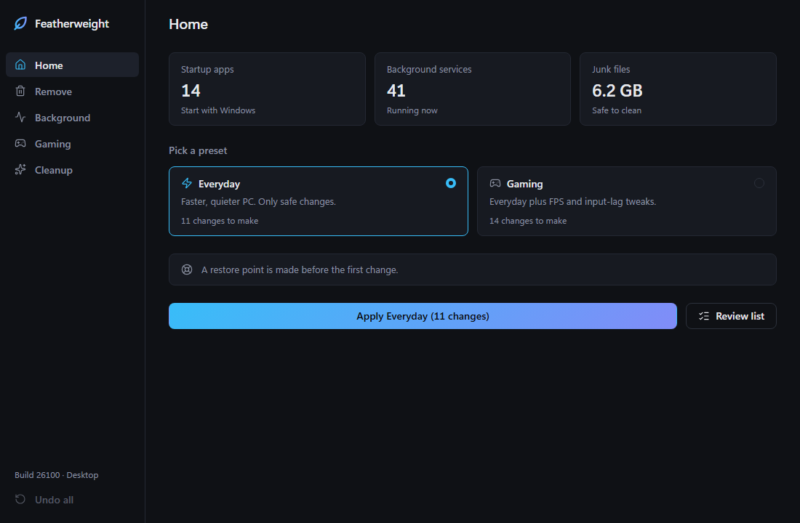

<p align="center">
  <picture>
    <source media="(prefers-color-scheme: dark)" srcset="assets/logo/readme-header-dark.svg">
    <source media="(prefers-color-scheme: light)" srcset="assets/logo/readme-header-light.svg">
    
  </picture>
</p>

<p align="center">
  A Windows optimizer and debloater that explains every change and can undo it.
</p>

<p align="center">
  <a href="LICENSE"></a>
  
  
</p>

<!-- TODO: replace with demo GIF -->
<p align="center">
  
</p>

Featherweight removes preinstalled junk, ads, Copilot and Recall, calms background activity, applies a handful of well-known gaming tweaks, and cleans junk files. Pick a preset and click once, or go through each section and choose for yourself.

## Why Featherweight

There are plenty of debloat scripts. Featherweight is built for people who want to know what is happening to their PC.

- **Every change is explained.** Each tweak has a plain description and shows the exact change it makes: the registry path and value, the service, the scheduled task, the app package.
- **A restore point comes first.** Before the first change of a session, Featherweight creates a Windows restore point.
- **Undo per change, or Undo all.** Every change is recorded before it runs. Undo any single tweak from its panel, or roll back everything with one button.
- **Status is read from the live system.** A tweak shows as applied, not applied or partly applied based on what Windows actually reports, not on what the app remembers.
- **Safe and Advanced are labelled.** Presets only use Safe tweaks. Advanced ones are off unless you turn them on, and each says who should skip it.

## What it changes

Every tweak is a small TOML file in [`tweaks/`](tweaks). The lists below come from those files. Tweaks that don't apply to your Windows version or edition are hidden automatically.

### Remove

| Tweak | Level | In presets |
|---|---|---|
| Remove preinstalled junk apps (Candy Crush, Solitaire, Clipchamp, News and others) | Safe | Everyday, Gaming |
| Stop Windows installing suggested apps | Safe | Everyday, Gaming |
| Turn off Copilot in Windows | Safe | Everyday, Gaming |
| Turn off Recall | Safe | Everyday, Gaming |
| Turn off Widgets and News | Safe | Everyday, Gaming |
| No Bing web results in Start search | Safe | Everyday, Gaming |
| No ads or suggestions in Start and Settings | Safe | Everyday, Gaming |
| No tips or ads on the lock screen | Safe | Everyday, Gaming |
| No ads in File Explorer | Safe | Everyday, Gaming |
| Uninstall OneDrive | Advanced | None |
| Remove Xbox apps | Advanced | None |

### Background

| Tweak | Level | In presets |
|---|---|---|
| Startup apps: see everything that launches at boot and switch items off (the same mechanism Task Manager uses) | You choose | None |
| Turn off diagnostic data services | Safe | Everyday, Gaming |
| Turn off diagnostic data tasks | Safe | Everyday, Gaming |
| Turn off rarely used services (fax, offline maps, store demo mode, Media Player network sharing) | Safe | Everyday, Gaming |
| Turn off printing | Advanced | None |
| Turn off Bluetooth support | Advanced | None |

### Gaming

| Tweak | Level | In presets |
|---|---|---|
| Game Mode on | Safe | Gaming |
| Game Bar recording off | Safe | Gaming |
| Mouse acceleration off | Safe | Gaming |
| High Performance power plan | Safe on desktops, Advanced on laptops | Gaming (desktops) |
| Ultimate Performance power plan | Advanced | None |
| Network throttling off | Advanced | None |
| Less CPU reserved for background tasks | Advanced | None |

### Cleanup

Shows the size of each item before cleaning and the total freed afterwards. Deleted files can't be brought back, and the app says so before it starts.

- Your temporary files
- Windows temporary files
- Old Windows Update downloads
- Thumbnail cache
- Delivery Optimization cache

## Presets

- **Everyday** applies every Safe tweak in Remove and Background, plus Cleanup. Startup apps are left for you to pick.
- **Gaming** is Everyday plus the Safe gaming tweaks.

**Review list** shows exactly which tweaks a preset will apply, with a switch to drop any of them first. Anything that can't be undone with one click (app removal, cleanup) gets its own confirmation screen listing the apps and the sizes involved.

## What it will never do

The project counts as a failure if it does any of these, even if it works:

- Turns off Windows Defender or blocks Windows Update entirely.
- Ships "RAM cleaners", "registry cleaners" or placebo "boosters".
- Changes anything silently, or anything it can't explain in the UI.
- Leaves a PC in a state the user can't get back from.
- Collects any telemetry of its own, or bundles anything.

## How undo works

- **A journal, written first.** Before any change runs, the previous state of each value it touches (each registry value, service and scheduled task) is written to a journal in `%ProgramData%\Featherweight\`. The journal survives reinstalling the app.
- **Undo this one, or Undo all.** Undoing replays the journal in reverse, either for one tweak or for everything.
- **The "changed since" rule.** Featherweight only restores a value if it is still what Featherweight set. If Windows Update, you or another tool changed it in the meantime, that item is left alone and reported as changed since, with a **Restore anyway** button if you want the old value back regardless.
- **No overlaps.** No two tweaks touch the same value, so undoing one never undoes part of another.
- **Removed apps are reinstalled, not undone.** Apps removed in the Remove section come back by reinstalling them from the Microsoft Store. The app marks these clearly before you apply them. Undoing "Uninstall OneDrive" reinstalls OneDrive, and you sign in again.
- **Cleanup is final.** Deleted temp and cache files are gone; Windows recreates what it needs.
- **The restore point** is there as a second safety net if something outside Featherweight's journal goes wrong.

## Install

Download the latest version from [Releases](../../releases):

- `Featherweight_x.y.z_x64-setup.exe` is the installer.
- `featherweight-portable.exe` runs without installing.

Featherweight needs Windows 10 22H2 or Windows 11 23H2 or newer (x64), and asks for administrator rights when it starts.

Featherweight isn't code-signed yet, so Windows SmartScreen may warn you. Click More info → Run anyway, or build it yourself from source.

## Build from source

You need:

- [Node.js](https://nodejs.org/) 24 (what CI uses)
- [Rust](https://rustup.rs/) stable with the MSVC toolchain (install the Visual Studio C++ Build Tools when rustup asks)

```sh
npm ci
npm run tauri build
```

The installer lands in `src-tauri/target/release/bundle/nsis/` and the portable exe is `src-tauri/target/release/featherweight.exe`.

For development, `npm run tauri dev` starts the app with hot reload. Run the Rust tests with `cargo test --manifest-path src-tauri/Cargo.toml`.

## Testing safely

Don't test tweaks on the PC you use every day. Use Windows Sandbox or a virtual machine, and follow the [sandbox checklist](docs/sandbox-checklist.md) before any release that changes `tweaks/`.

## Contributing

Bug reports and pull requests are welcome.

**Adding a tweak** means adding one TOML file to [`tweaks/`](tweaks): an `id`, a `title`, a plain `description` of what it does and who should skip it, a `section`, a `level` (`safe` or `advanced`), its `presets`, and a list of actions (`registry`, `service`, `scheduled_task`, `appx`, `power_plan`, or `powershell` with an explicit undo script as a last resort). Look at an existing file for the format.

Your tweak must pass `cargo test --manifest-path src-tauri/Cargo.toml`. The tests load the whole catalog and fail if:

- two tweaks change the same value, or
- a tweak touches Windows Defender or Windows Update.

Please also run it through the [sandbox checklist](docs/sandbox-checklist.md) and say in the pull request which Windows builds you tried.

## License

[MIT](LICENSE)
